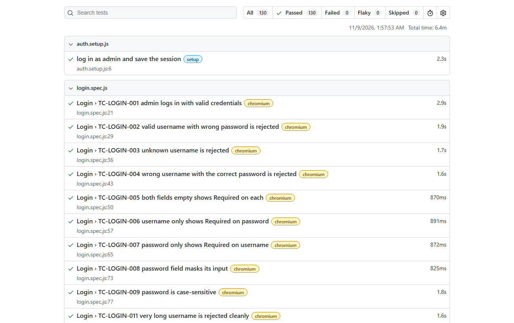
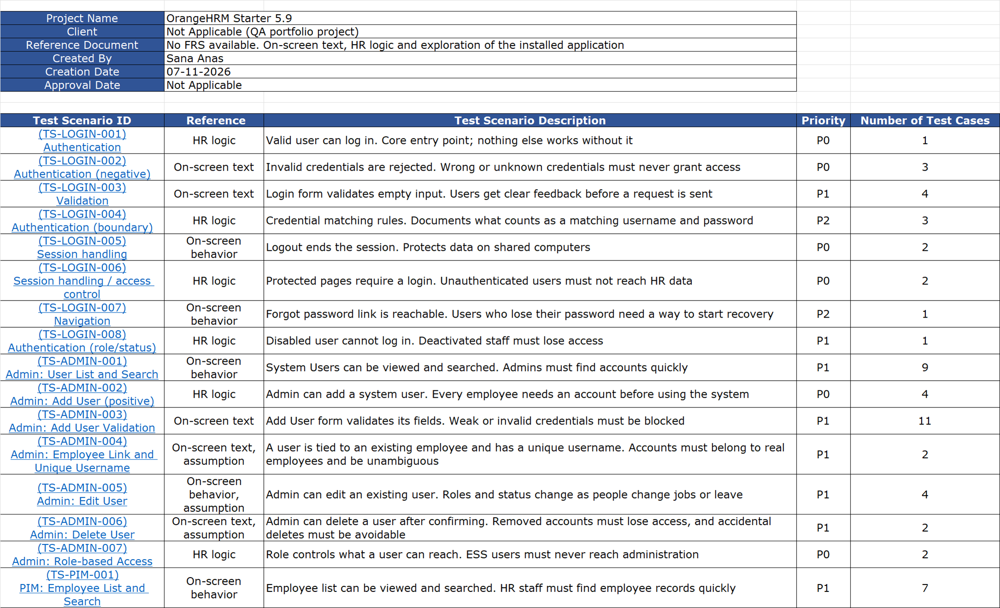
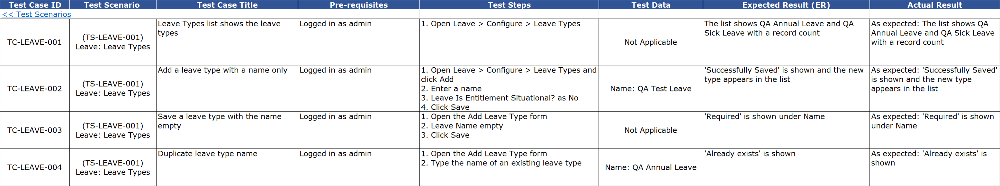
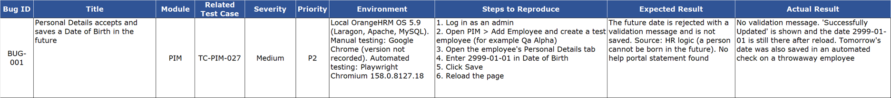
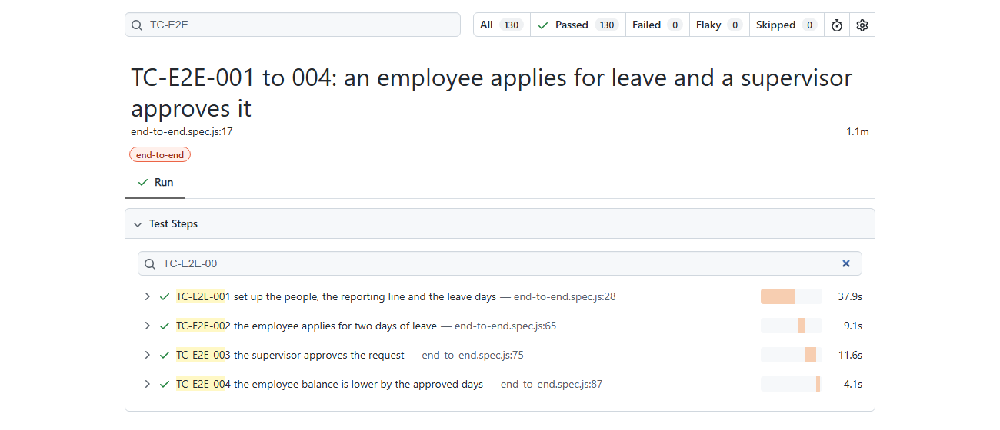

# OrangeHRM QA Portfolio


**A complete QA exercise on a real HR system.** The application under test is OrangeHRM Starter 5.9, an open-source human resources product. The project covers logging in, user administration, employee records, leave management, and the everyday story of an employee asking for leave and a manager approving it.

It delivers two things that work together:

1. **A test case workbook (Excel)** with 140 designed test cases, their results from hands-on testing, and a defect report.
2. **An automated test suite (Playwright and JavaScript)** that repeats 132 of those cases in about six minutes.

Both use the same test case IDs, so any manual case can be matched to its automated test in seconds.

## Results at a glance

| Module | Test cases | Pass | Fail | Observation | Cases automated |
|---|---|---|---|---|---|
| Login | 17 | 16 | 0 | 1 | 15 |
| Admin: user management | 34 | 32 | 0 | 2 | 32 |
| PIM (employee records) | 39 | 35 | 1 | 3 | 36 |
| Leave | 46 | 45 | 0 | 1 | 45 |
| End-to-end workflow | 4 | 4 | 0 | 0 | 4 (as one test with one step per case) |
| **Total** | **140** | **132** | **1** | **7** | **132 cases, in 129 tests** |

**One defect found (BUG-001):** the Personal Details page accepts and saves a Date of Birth in the future. The report has steps, expected and actual results, environment, reproducibility and screenshots, and the automated test for it is marked as an expected failure until the bug is fixed.

**Seven observations:** behavior with no documented expected result is logged as an observation, not as a defect, so nothing is called a bug without evidence. An example is whether the Admin username search matches part of a name.


*Latest full run: 130 of 130 tests passed in 6.4 minutes, with no failed or flaky tests.*

## What this project demonstrates

- **Test design.** Scenarios and cases cover positive, negative, validation, boundary and permission situations, each with a priority (P0 to P3).
- **Evidence-based expectations.** Every expected result names its source: on-screen text, the vendor's help portal, HR logic, or a labelled assumption. Behavior without a documented expectation stays an observation until one exists.
- **Clear defect reporting.** BUG-001 follows the standard structure and is backed by a manual reproduction, an automated reproduction and screenshots.
- **Business-rule testing.** The Leave module is tested against real rules: weekends and holidays are not counted as leave days, a pending request already reduces the balance, overlapping or over-balance requests are refused, and nobody can approve their own leave.
- **Role-based access.** Admin, supervisor and employee are each checked for what they can and cannot reach.
- **Automation engineering.** Page objects, test data created through the application's API, guaranteed cleanup, tests that involve several people at once, and no fixed waits.
- **Reliability work.** The suite was run repeatedly and stress-tested, and the database was compared before and after every full run to prove nothing is left behind.
- **Honest reporting.** Manual and automated results are recorded separately, so every case shows both what was verified by hand and what the automation verifies.

## A two-minute tour

1. Open the workbook: [`manual-testing/OrangeHRM-TestCases.xlsx`](manual-testing/OrangeHRM-TestCases.xlsx). Start with the `Test Scenarios` sheet, then any module sheet.
2. Read the defect report on the `Bug Reports` sheet, with screenshots in [`manual-testing/evidence/BUG-001/`](manual-testing/evidence/BUG-001/).
3. Open an automated test, for example [`automation/tests/leave-requests.spec.js`](automation/tests/leave-requests.spec.js), and match a test title to its case ID in the workbook.

| Scenarios and priorities | Leave test cases |
|---|---|
|  |  |



## Behavior confirmed in the application

Findings from hands-on testing of the installed application:

- Pending leave counts against the balance straight away. Approving it keeps the days reserved, and rejecting or cancelling it returns them.
- A request for a weekend or a public holiday only is refused. A range that includes them counts only the working days.
- A supervisor sees and decides the leave of the people reporting to them, and never their own. The admin sees everyone's.
- An administrator can assign leave directly. It is scheduled immediately, with no approval step.
- Deleting an employee also removes the linked login, and a deleted or disabled user cannot sign in.
- An employee who opens an administration page by its address gets a "Credential Required" message and no data.
- The Admin username search matches the whole username, not part of it. No documentation says whether that is intended, so it is recorded as an observation.
- The Add User form and the Add Employee form word the "already exists" message differently.

## Scope

| Area | Focus |
|---|---|
| Login | Authentication, negative cases, validation, session handling |
| Admin: user management | Add, edit, delete, search, validation, role-based access |
| PIM | Employee forms, validation and boundaries, reporting lines, delete |
| Leave | Leave setup, working-day and balance rules, approval workflow, role behavior |
| End-to-end | An employee applies for leave and a supervisor approves it |

## The test case workbook

`manual-testing/OrangeHRM-TestCases.xlsx` has one sheet per module (`Login`, `Admin`, `PIM`, `Leave`, `End-to-End`), a `Test Scenarios` sheet, a `Bug Reports` sheet and a `Version History` sheet.

- Each case has an ID (`TC-LEAVE-036`), its scenario (`TS-LEAVE-006`), preconditions, steps, test data, expected result, actual result, priority and result.
- The `Comments` column records the **source of the expected result**, the automation status and the manual run date.
- Results are PASS, FAIL, Blocked, Not Tested or Observation.

## How an automated test reads

Each test title starts with the case ID, and the test reads like the case it automates:

```js
test('TC-LOGIN-002 valid username with wrong password is rejected', async ({ page }) => {
  await loginPage.login(username, 'wrong-password-1');

  await expect(loginPage.invalidCredentialsAlert).toBeVisible();
  await expect(page).toHaveURL(LOGIN_URL);
});
```

The test signs in with a wrong password, then checks that an error message appears and the user stays on the login page. The page object (`LoginPage`) holds the details of the screen, so the test reads like the case.

Larger tests, such as the Leave approval workflow, create their people through the application's API and remove them afterwards. The behavior being tested always goes through the real screens.

The end-to-end story is one test with one named step per test case, so the report shows each case on its own:



## Tools

- **Playwright** with plain JavaScript (Node.js 22) and its built-in HTML report.
- **dotenv** for the application address and the admin credentials, which are read from a private `.env` file.
- **Microsoft Excel** for the test case workbook.
- **Git and GitHub** for version history.

## Project layout

```
manual-testing/
  OrangeHRM-TestCases.xlsx      scenarios, test cases, results and bug reports
  evidence/BUG-001/             screenshots for the bug report
automation/
  playwright.config.js          projects, saved admin session, 3 workers
  fixtures.js                   test data setup and cleanup, sign-in as other users
  helpers/leaveApi.js           applying and approving leave through each person's session
  pages/                        page objects: one file per screen
  tests/                        specs; every test title starts with its test case ID
docs/images/                    pictures used in this README
```

## How to run

Requires Node.js 22 or later and a running local OrangeHRM.

```
cd automation
npm install
npx playwright install chromium
copy .env.example .env        # then fill in BASE_URL, ADMIN_USERNAME and ADMIN_PASSWORD
npx playwright test                       # everything
npx playwright test --project=chromium    # Login tests only
npx playwright test --project=admin       # Admin tests
npx playwright test --project=pim         # PIM tests
npx playwright test --project=leave       # Leave tests (need the Leave prerequisites below)
npx playwright test --project=end-to-end  # the end-to-end story
npx playwright show-report
```

**Leave prerequisites.** The Leave tests need a one-time setup in the application: a leave period from January 1 to December 31, two leave types named `QA Annual Leave` and `QA Sick Leave`, and a holiday named `QA Holiday` on 2026-12-25. The tests use dates in December 2026. Each test creates its own employees and entitlements and removes them afterwards.

## Design decisions

- **Simple page objects**, one per screen, holding selectors and actions. Assertions stay in the tests.
- **User-facing locators** (role, label, text) wherever the application offers them. CSS is used only where it does not, with a comment saying why.
- **No fixed sleeps.** Tests rely on Playwright's auto-waiting and web-first assertions, and each page object waits for its page to finish loading before the test acts.
- **Independent tests.** Each test creates uniquely named data and can run alone and in any order.
- **API for setup, screens for testing.** Employees, users, entitlements and leave requests used as test setup are created through the application's own web API, which is much faster than clicking through forms. The behavior being tested always goes through the real screens.
- **Safe cleanup.** Everything a test creates is removed by exact id or exact name, never by position in a list, and cleanup still runs when a test fails. This matters because manual and automated testing share one database.
- **Several people in one test.** A fixture opens a separate logged-in session for each person, for example an employee and a supervisor.
- **Three tests at a time.** The local application slows down under heavier load, which makes the busiest tests time out.

## Good to know

- The suite runs against a local OrangeHRM installation, with the address set in `.env`.
- The Leave tests use dates in December 2026 and rely on the one-time Leave setup described above.
- Manual testing and automation share one database, so they are run one after the other.

## Author

Sana Anas

